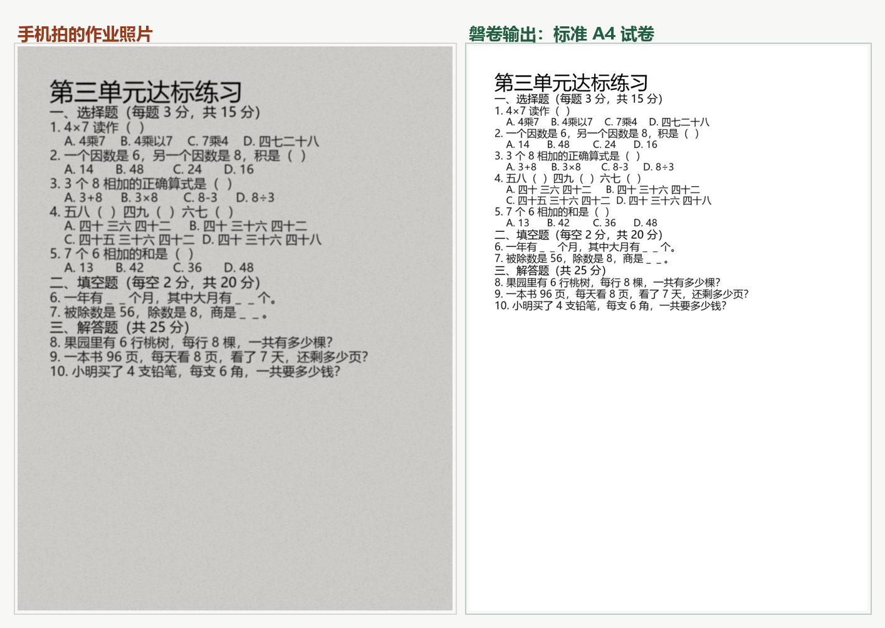

# 磐卷 PaperForge

[English](README.md) · **[中文](README.zh-CN.md)**

> **Whatever the teacher sends, print it as one clean A4.**
> 老师发什么，磐卷印什么——一张干净 A4。

Turn the PDFs, photos and Word files your kid's teacher dumps into the group chat into **one standard A4 exam paper PDF** — ready to print, or to be answered on screen, auto-graded, and sent back to the teacher as a PDF with the score on it.



## Why

It is 10pm on Saturday. The teacher posts three photos of a maths worksheet: *"needed by 9am tomorrow."* The print shop is closed. Your printer has been out of ink for a month. You are staring at a crooked, grey, unreadable photo.

Or: it is Sunday morning and there are seven parents queueing at the print shop, each holding a photo of the same worksheet.

**Kids are not short of exercises. They are short of one clean, standard, printable sheet of A4.**

## Before / After

| Before | After |
|---|---|
| Print shop closed at night and on weekends | A standard A4 paper in 1–2 seconds, any hour |
| Blurry, grey, crooked photos | Automatic clean-up: grey background removed, deskewed, cropped, enhanced |
| One PDF + two photos + a Word doc, stitched by hand | Drop them all in together, merged into one paper, zero layout work |
| Hundreds of dollars a year on printing and ink | Grayscale-first, ink-saver mode, adjustable font size, 2-up duplex |
| Re-do the homework photo loop to hand it in | Answer on screen → auto-grade → export a PDF with the score on it |

## The four steps

| Step | What you do | Notes |
|---|---|---|
| **1 Upload** | Drop the PDFs / photos / Word doc the teacher sent | Mixed formats are fine, the order is the page order |
| **2 Proofread** | Edit / add / delete questions, then **Publish** | Recognition is never perfect; fixing it is the uploader's job, and publishing is what closes that step |
| **3 Answer on screen** | The kid answers on the machine: taps choices, types fill-ins, writes out the working | **You can skip this step entirely** and go straight to printing a blank paper |
| **4 Print to PDF** | Pick the content, tune the layout, download or print | Three contents, see below |

### What step 4 puts on the paper

| Content | Available when | On the sheet |
|---|---|---|
| **Blank paper** | Questions exist (even before publishing) | Clean questions plus answer space |
| **My answers** | Step 3 was submitted | The kid's answers, not marked |
| **My answers + auto-grading** | Submitted **and** a marking key exists | Vector-drawn ✓/✗/△ (they survive black-and-white printing) plus the score in the header |

The two unavailable choices stay visible **with the reason written inside them**
("nobody has answered this paper yet — do step 3 first, or print the blank one").
A greyed-out control with no explanation just gets clicked again.

Layout changes re-render the preview by themselves after 450 ms. Preview PNGs are named
after a hash of everything that decides their pixels, so "I changed it but the preview
did not move" cannot come back through browser caching.

## Quick start

### Easiest: no-install build (no Python needed)

Grab **`磐卷-Windows-免安装.zip`** from [Releases](../../releases), **extract it**
(do not run from inside the zip), double-click `PaperForge.exe`. Your browser opens
`http://127.0.0.1:8000/` and you can drop homework files in. Python and every dependency
(including the OCR models) are inside the folder — still fully local, no network, no account.
That console window *is* the server: close it and the app stops; your papers live in `data\`
next to the exe. Windows may warn "protected your PC" on first run — choose
*More info → Run anyway* (the build is unsigned; see [docs](docs/打包与发布.md)).

### From source

**Windows: double-click `start.bat` in the project folder.** It finds Python 3.11+,
creates a venv and installs dependencies on first run, starts the local server in the
background, waits until `/api/health` actually answers, then opens your browser.
Double-clicking again will not start a second server — it just opens the page.
`stop.bat` shuts it down.

```powershell
.\scripts\start.ps1            # first start takes ~10s
.\scripts\start.ps1 -Status    # RUNNING / STOPPED
.\scripts\stop.ps1
```

Any other platform:

```bash
python3.11 -m venv .venv
.venv/bin/python -m pip install -r requirements.txt
.venv/bin/python -m uvicorn app.main:app --host 0.0.0.0 --port 8000
# open http://127.0.0.1:8000/
```

Requires **Python 3.11+**. The launchers look for 3.11+ explicitly rather than trusting whatever `python` resolves to on PATH.

### Forgot to start the server? There is a button for that

Opening `web/index.html` by double-clicking still works, because every page now probes the local
server and reacts:

* **server running** → a green bar appears and moves you to the real address `http://127.0.0.1:8000/`
  (a page opened straight off disk is a degraded mode, there is no reason to stay in it);
* **server not running** → an amber bar with a **「▶ 启动服务」** button. Click it, the server starts,
  and the page walks itself into the app.

The physical limit worth stating: **a web page is not allowed to launch a local program** — browser
sandbox, no website can do it. The button therefore hands off to a Windows custom protocol
(`panjuan://`), registered under your own `HKCU\Software\Classes\panjuan` (no admin rights needed)
the first time you double-click `start.bat`. Your browser will ask once whether it may open
PaperForge; tick "always allow" and it never asks again.

```powershell
.\scripts\install_startup.ps1            # just the registration (start.bat already does it)
.\scripts\install_startup.ps1 -Check     # registered? pointing at which folder?
.\scripts\install_startup.ps1 -AutoStart # start the server at logon - no button needed at all
.\scripts\install_startup.ps1 -Remove    # undo everything
```

## Privacy-first, and I mean it

Children's homework is minors' data. This tool:

- runs entirely on your own machine — no uploads, no accounts, no telemetry
- makes **zero external network requests**, including no CDN on the frontend
- keeps task data in memory only; restart clears everything
- ships its real-world test fixtures out of the repo (`samples/private/` is gitignored)

The code is MIT-licensed and auditable. That is the whole privacy policy.

## What it does today (measured, not promised)

| | Status |
|---|---|
| A · clean printable paper (A4 or A3 spread) | ✅ shipped (V1.0 / V1.1) |
| B · answer on screen | ✅ shipped (V1.1) |
| C · auto-grade and send back | ✅ shipped (V1.1) |

**Proofread first, then answer.** After recognition the paper lands on a proofreading page
where the uploader edits / adds / deletes questions and finally **publishes** it.
Only published papers can be answered, and the answering page has no editing controls at all —
the person doing the homework should not be the one fixing the questions.

**Three print formats**: `A3 spread` (the standard exam-paper look — two A4 pages side by side at
1:1 scale, with a sealing strip and a binding seam; fold it and you have an A4 booklet),
`A4 single`, and `A4 2-up` (√2 shrink, saves paper).

**Question figures survive.** Regions that contain ink outside the text lines (number lines,
direction diagrams, "look at the picture and write the multiplication") are cropped at 200 DPI
and attached to the question — visible in proofreading, on the answering page, and in the
exported PDFs.

Verified against real teaching material with `py -3.11 tests/acceptance.py` — **11/11 acceptance cases pass**, and they pass both with real samples and with only the synthetic ones that ship in the repo (so a stranger who clones this gets the same result):

```
F01 phone photo → A4 in 1.1s (limit 10s)      F07 header row toggles on/off
F02 mixed formats merged into one paper        F08 corrupt file reported, others unaffected
F03 text PDF reflowed, 0 garbled chars         F09 100 pages, 0 lines lost, 59MB RAM
F04 scanned PDF cleaned and embedded           F10 preview renders
F05 ink-saver: page whiteness 7.8% → 85.5%     F11 footer attribution can be turned off
F06 2-up: 3 pages → 2
```

V1.1 (on-screen answering + grading) is verified by `py -3.11 tests/acceptance_v11.py` — **7/7**:

```
F11 question splitting   106 numbered lines in 7 real papers → 100% cut into
                         separate questions; 0 duplicate numbers inside a section
F12 answer on screen     choice / fill / judge / essay controls all submit;
                         reload brings the draft back; with no key saved, 7 questions
                         are marked "needs review" and 0 are wrongly marked wrong
F13 parent does it once  "save my answers as the key" → re-doing the same paper
                         comes back with 0 wrongly-marked questions
F14 tolerant fill-in     1/2 ≡ 0.5 ≡ ０．５, 二十四 ≡ 24, 二分之一 ≡ 1/2, 48个 ≡ 48;
                         a genuinely wrong answer is still marked wrong
F15 graded PDF export    A4, class/name/score header, ✓/✗/△ drawn as vector marks
                         (no colour, so it survives black-and-white printing)
F16 proofread CRUD       edit / add / delete / publish all work; an unpublished
                         paper refuses submissions with 409, and the answering page
                         has no editing control at all
F17 one-click start      all four pages mount js/gate.js, HTML comments balance, and
                         the registered panjuan:// handler points at this checkout
F18 step-4 contents      blank / my-answers / answers+grading produce three distinct
                         PDFs: the answer string is absent from the blank sheet and
                         present on the other two, only the graded sheet has a numeric
                         score in the header, and A4→A3 changes both the preview hash
                         and the page geometry (tests/break_flowgate.py breaks each of
                         those three on purpose; F18 went red all three times)
```

Grading is deliberately conservative: anything the rules are not sure about becomes
**"needs review" (△)** rather than "wrong" — a wrongly-marked question gets a kid scolded
for something they got right. Essay questions are never auto-scored (PRD rule); they only
show a keyword-overlap hint.

## Known limits (stated up front, so you don't wait for them)

- **No `.doc`** (Word 2003 and earlier). Save as `.docx`.
- **No handwriting recognition.** "Photograph the completed worksheet and auto-grade it" is a paid commercial API category, not an open-source one. The path this project takes instead: let the kid **answer on screen**, which removes handwriting from the problem entirely.
- **No pretty maths typesetting.** Formulas are handled as text or image blocks.
- **On-screen mode depends on OCR.** When a question's text lives entirely inside a figure
  or table, the scanner can still cut out the question number but not the stem; those are
  flagged for review (2 out of 122 questions on real material). Printing (mode A) is
  unaffected — it uses the page image itself.
- **Essay questions are never auto-scored.** They show a keyword hint and wait for a human.

## Stack

FastAPI + uvicorn · PyMuPDF (PDF parsing) · Pillow + OpenCV (image clean-up) · ReportLab (A4 output, embeds a subset of the system CJK font) · RapidOCR (on-device OCR, Apache-2.0, models ship with the package) · SQLite (V1.1 papers / questions / answer keys / submissions) · plain HTML/CSS/JS frontend, zero build step, zero CDN

## For developers

Read `docs/` before changing code. It records **hypotheses that measurement disproved**, not design wishes — why column detection must run on raw fragments rather than merged text lines, why image clean-up must be keyed on sharpness rather than pixel count, why section detection has to be ordinal rather than a keyword list, and why "never mark anything wrong" is not the same as "safe". Skipping those will cost you a day each.

Run everything: `scripts/check.bat` (Windows, 15 steps). Three of those steps are **checks on the checks**: `tests/break_extractor.py`, `tests/break_grading.py` and `tests/break_webgate.py` re-inject already-fixed defects into the source (segmentation rules, grading predicates, and the frontend/launcher gates themselves) and require the matching tests to go red. A green test suite only proves the code satisfies the assertions, not that the assertions can catch anything — this project has been fooled by a falsely-green gate four times, the last one being an unterminated HTML comment that swallowed a `<script>` tag and the `<body>` opening while every gate stayed green.

## License

MIT — free forever, no ads, no paid tier.

> If your kid also prints homework every week, a ⭐ helps this reach the next parent.
